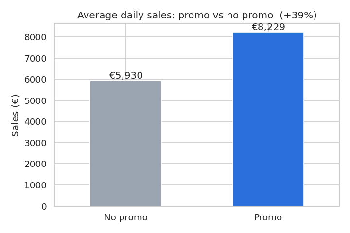

# Sales Forecasting and Promotion Optimization for Retail

**Final Year Project — BSc Computer Science & Artificial Intelligence, University of Birmingham Dubai**
Author: Yahya Alkayem

## Research question
Can machine learning accurately forecast daily retail sales, and can those forecasts be used to decide **which stores should run promotions, and when**, to maximize total sales under a limited promotion budget?

## Dataset
**Rossmann Store Sales** — [Kaggle competition](https://www.kaggle.com/competitions/rossmann-store-sales)

| | |
|---|---|
| Source | Rossmann, one of Germany's largest drugstore chains |
| Size | 1,017,209 daily records · 1,115 stores |
| Period | 1 Jan 2013 – 31 Jul 2015 (942 days) |
| Files used | `train.csv` (daily sales, promos, holidays) · `store.csv` (store type, assortment, competition, Promo2) |

Key findings from the initial exploration ([notebook](notebooks/01_data_exploration.ipynb)):
- Sales data is complete — no missing values in `train.csv`; gaps only in store metadata.
- Promotions raise average daily sales by roughly 40%, **but the uplift varies widely by store** (from about −7% to +145%). This is the basis for the optimization.
- Clear weekly, yearly (December peak) and holiday patterns to support forecasting.



## Planned approach
1. **Exploration & cleaning** ✅ — `notebooks/01_data_exploration.ipynb`
2. **Feature engineering** — calendar, holiday, competition and promo-history features
3. **Forecasting** — naive baseline → linear regression → gradient boosting (LightGBM / XGBoost), evaluated with RMSPE on a time-based split
4. **Promotion optimization** — estimate each store's sales with vs. without a promo, then allocate a limited number of promo days to maximize total sales (greedy / linear programming)
5. **Business output** — recommendations and a simple dashboard for a retail manager

## Repository structure
```
├── data/            # place train.csv and store.csv here (not committed)
├── notebooks/       # Jupyter notebooks, numbered in order
├── figures/         # charts exported from notebooks
└── README.md
```

## How to run
1. Download `train.csv` and `store.csv` from the [Kaggle competition page](https://www.kaggle.com/competitions/rossmann-store-sales/data) into `data/`
2. `pip install pandas numpy matplotlib seaborn jupyter`
3. Open `notebooks/01_data_exploration.ipynb`
